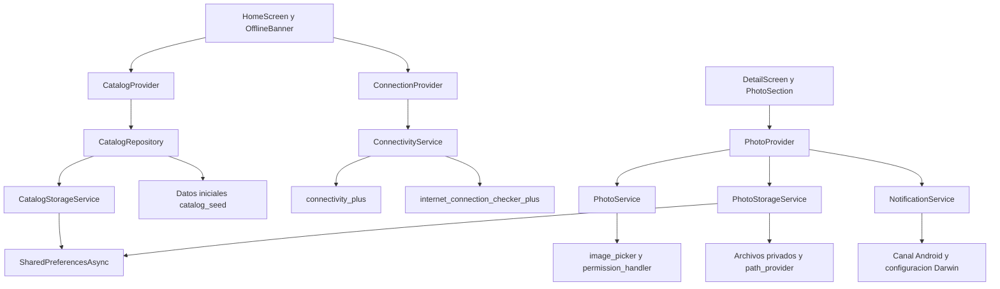

# Relicarium II

Catálogo interactivo de artefactos legendarios desarrollado con Flutter y Dart. Permite explorar reliquias, consultar su detalle y asociar una fotografía personal a cada una mediante cámara o galería.

Este proyecto reutiliza y evoluciona **RELICARIUM, de la Actividad Integradora 1**, para la Actividad Integradora 2 de Desarrollo de Aplicaciones Móviles de ECOTEC. La nueva etapa incorpora rebranding, servicios del dispositivo, persistencia local y gestión de estado con Provider. No procesa compras ni pagos reales.

## Plataforma y estado

- **Android:** plataforma de ejecución y pruebas manuales de esta entrega.
- **iOS:** incluye configuración Dart de notificaciones, identidad y descripciones de permisos nativos. Su integración, compilación y funcionamiento requieren validación adicional en macOS con Xcode. No se presenta como una versión probada.
- Linux, Windows, macOS y web no son plataformas funcionales verificadas del producto, aunque existan carpetas generadas por Flutter.

## Funcionalidades

- Catálogo de ocho reliquias con tarjetas pulsables y pantalla de detalle. El objeto `Product` seleccionado se transfiere al detalle.
- Identidad Relicarium II, interfaz oscura con acentos celestes, icono personalizado y splash nativo estático de Android.
- Detección de cambios de red y comprobación de acceso efectivo a Internet. El banner offline desaparece al recuperar la conexión.
- Catálogo serializado en JSON y persistido mediante `SharedPreferencesAsync`.
- Captura con cámara y selección mediante el selector de imágenes del sistema.
- Solicitud de permiso de cámara y manejo de denegación, incluido acceso a Ajustes cuando el permiso se encuentra bloqueado.
- Previsualización antes de guardar. Se solicita al selector limitar la imagen a 1600 × 1600 píxeles y usar calidad 75; el procesamiento efectivo depende del formato y de la plataforma. No hay editor de recorte manual.
- Fotos copiadas al almacenamiento privado persistente de la aplicación, asociadas a cada reliquia.
- Notificación local «Foto guardada» tras guardar correctamente una foto, con canal de Android y solicitud de autorización. Denegar notificaciones no impide guardar la imagen.

## Actividad Integradora 3 — Archivo del museo

Relicarium II consulta la API pública del Art Institute of Chicago para mostrar 12 armaduras históricas de dominio público. La consulta utiliza una
petición GET sin autenticación y muestra el título, la fecha y el lugar de origen.

- [Consulta usada por la app](https://api.artic.edu/api/v1/artworks/search?q=armor&limit=12&fields=id%2Ctitle%2Cdate_display%2Cplace_of_origin%2Cimage_id&query%5Bterm%5D%5Bis_public_domain%5D=true)
- [Documentación del museo](https://api.artic.edu/docs/)

`MuseumApiService` realiza la consulta con `http` y convierte los elementos de
`data` en objetos `MuseumArtwork`. `MuseumProvider` comunica los estados de
carga, éxito y error a la pantalla.

Con un emulador Android encendido, ejecuta desde la raíz del proyecto:

```sh
flutter pub get
flutter run
```

Abre **Archivo del museo** desde el catálogo. Desliza la lista hacia abajo para
consultar de nuevo. Ante un error, puedes pulsar **Reintentar**. Si una imagen
no está disponible, la tarjeta conserva los datos de la pieza y muestra un
icono de museo.

## Requisitos

Entorno utilizado: Flutter **3.47.8** con Dart **3.13.7**, Windows y emulador Android Pixel 10. El `pubspec.yaml` declara Dart `^3.13.7`; utiliza un Flutter que incluya una versión compatible.

Se necesitan Flutter disponible en `PATH`, Android SDK y herramientas de compilación, licencias aceptadas y un emulador o dispositivo Android autorizado para depuración. El proyecto usa Android Gradle Plugin 9.1.0, Gradle Wrapper 9.3.1 y compatibilidad de código Java/Kotlin 17. La ejecución de Gradle se realizó con el JBR de Android Studio.

El entorno validado compila con Android SDK 36. Conserva el Gradle Wrapper y el archivo `pubspec.lock` del repositorio para reproducir las dependencias. En Windows, los plugins requieren soporte de enlaces simbólicos, disponible mediante el Modo de desarrollador.

No se requiere una clave de API, cuenta externa ni servidor propio. La primera descarga de paquetes, recursos de Flutter y dependencias de Gradle sí necesita Internet en la computadora.

## Instalación y ejecución

```powershell
git clone https://github.com/joseandresmendoza64/relicarium-flutter.git
cd relicarium-flutter
git switch develop
flutter doctor -v
flutter pub get
flutter devices
flutter run
```

Durante el desarrollo de la segunda actividad, `develop` contiene los avances. Después de su integración final, la rama estable `master` también contendrá la entrega.

Para elegir un dispositivo concreto:

```powershell
flutter run -d ID_DEL_DISPOSITIVO
```

Sustituye `ID_DEL_DISPOSITIVO` por el identificador que devuelva `flutter devices`.

Si aún no hay un emulador encendido:

```powershell
flutter emulators
flutter emulators --launch ID_DEL_EMULADOR
```

Sustituye el identificador por uno disponible en tu equipo. Espera a que Android termine de arrancar antes de ejecutar la app. Los cambios en permisos, plugins e iconos requieren recompilar; hot reload no basta para aplicarlos.

## Arquitectura

La interfaz presenta el estado y delega las operaciones a Providers. Los servicios encapsulan el acceso a plugins y almacenamiento. El repositorio del catálogo decide entre la copia persistida y los datos de inicialización.

```text
lib/
  main.dart
  data/catalog_seed.dart
  models/product.dart
  repositories/catalog_repository.dart
  providers/
    catalog_provider.dart
    connection_provider.dart
    photo_provider.dart
  services/
    catalog_storage_service.dart
    connectivity_service.dart
    notification_service.dart
    photo_service.dart
    photo_storage_service.dart
  screens/
    home_screen.dart
    detail_screen.dart
  widgets/
    product_card.dart
    offline_banner.dart
    photo_section.dart
```



`ConnectionProvider` cancela sus suscripciones al destruirse y vuelve a comprobar Internet al regresar la app al primer plano. Los Providers protegen las actualizaciones asíncronas después de `dispose`. La pantalla de detalle permite desplazarse cuando su contenido supera la altura disponible.

## Estrategia offline y persistencia

`CatalogRepository` consulta primero el catálogo persistido. Si no existe una copia válida, guarda y utiliza `catalog_seed.dart`. Si el almacenamiento produce una excepción de plataforma, utiliza los datos iniciales como respaldo. Home consume el repositorio mediante `CatalogProvider`.

La copia local no se sincroniza con un servidor: **este proyecto no tiene catálogo remoto**. Cambiar los datos iniciales no actualiza automáticamente una copia ya almacenada; una evolución posterior necesita una política de migración o actualización.

Las ilustraciones son recursos incluidos en la app. Las fotos personales se copian a `collection_photos` en su directorio de documentos privado, y su ruta se asocia a la clave estable `producto.imagen`. No se exportan automáticamente a la galería pública ni se suben a Internet.

La selección pendiente es temporal hasta pulsar «Guardar foto». Desinstalar la aplicación o borrar sus datos elimina su almacenamiento local. El código actual no implementa `retrieveLostData` para recuperar una selección si Android termina el proceso durante el selector; esa recuperación queda como mejora del manejo de ciclo de vida.

## Permisos y notificaciones

En Android se declaran `INTERNET`, `ACCESS_NETWORK_STATE`, `CAMERA` y `POST_NOTIFICATIONS`. Cámara y notificaciones se solicitan durante el uso de sus respectivas funciones. El selector de galería evita solicitar acceso general a todos los archivos.

`NotificationService` configura el canal `collection_photos`, usa el recurso monocromático `ic_stat_relicarium` y envía una alerta después del guardado. Usa el identificador de notificación `1`: una confirmación posterior reemplaza la anterior. El sistema y los ajustes del canal determinan si hay aviso emergente o sonido; la notificación también puede consultarse en el panel de Android.

Las comprobaciones de Internet realizan solicitudes a los puntos de verificación del paquete. No se utiliza ese servicio para transferir el catálogo o las fotos.

## Verificación y QA

```powershell
flutter analyze
flutter test
```

Se obtuvo un análisis sin incidencias y **dos pruebas de widgets aprobadas**:

1. Nueva marca, producto y cuadrícula visibles, sin banner cuando el estado controlado es online.
2. Banner offline visible y catálogo disponible cuando el estado controlado es offline.

Estas pruebas inyectan servicios y repositorio de prueba mediante implementaciones de sus interfaces. No prueban hardware, red real, almacenamiento nativo ni recepción de notificaciones.

Las pruebas manuales realizadas en Android comprenden:

| Caso | Resultado observado |
| --- | --- |
| Desconectar y reconectar Internet | Aparición y retirada del banner |
| Cerrar y volver a ejecutar el catálogo | Log de recuperación del almacenamiento local |
| Navegación sin Internet | Catálogo y detalle disponibles |
| Solicitud de cámara y captura | Permiso nativo, cámara y previsualización disponibles |
| Foto guardada por reliquia | Recuperación al volver a su detalle |
| Selección desde galería | Previsualización y guardado disponibles |
| Cámara bloqueada | Mensaje de orientación y botón para abrir Ajustes |
| Notificaciones autorizadas | Confirmación «Foto guardada» recibida en Android |
| Notificaciones desactivadas | La foto sigue guardándose |

Las capturas y los registros de estas comprobaciones se recopilan para el informe técnico final. La compresión solicitada se configura en el servicio; no se presenta aquí una medición comparativa del tamaño de los archivos.

## Versionamiento

- `master`: rama estable; conserva la primera entrega hasta integrar la segunda.
- `develop`: integración de los avances de Relicarium II.
- `actividad-1-final`: etiqueta que identifica el cierre de la primera actividad.

El historial separa nombre comercial, identificador Android, rediseño, icono/splash, configuración de compilación, conectividad, persistencia, fotos, notificaciones, pruebas y preparación de iOS. Los cambios de la segunda actividad superan el mínimo de cinco commits significativos.

## Dependencias y reproducción

Los servicios usan `provider`, `connectivity_plus`, `internet_connection_checker_plus`, `shared_preferences`, `image_picker`, `permission_handler`, `path_provider` y `flutter_local_notifications`. Las versiones exactas resueltas constan en `pubspec.lock`.

Se fijó `permission_handler` en **12.0.1** para conservar compatibilidad con la configuración Android del proyecto. Se fijó `flutter_local_notifications` en **22.3.3**: la versión 19.5.0 entraba en conflicto con el requisito `dbus` de conectividad. No se usan overrides para forzar esas dependencias.

Para regenerar los recursos Android después de cambiar sus imágenes o configuración:

```powershell
dart run flutter_launcher_icons
dart run flutter_native_splash:create
```

## Autoría y uso de IA

Proyecto académico de **Jose Mendoza Castro**, ECOTEC. Se utilizó ChatGPT/Codex como asistencia para diseño, código, resolución de errores, pruebas y documentación. El estudiante realizó la integración y las comprobaciones en su entorno. El icono del relicario se generó con asistencia de IA. Las capturas de ejecución corresponden a la aplicación en el emulador y se distinguen de diagramas o imágenes anotadas.

## Repositorio e informe

[Repositorio público de Relicarium II](https://github.com/joseandresmendoza64/relicarium-flutter).

El informe PDF final de la Actividad Integradora 2 se incorporará al repositorio al finalizar su revisión, junto con las evidencias seleccionadas. Se documentarán el rebranding, arquitectura, excepciones, QA y lecciones aprendidas.
